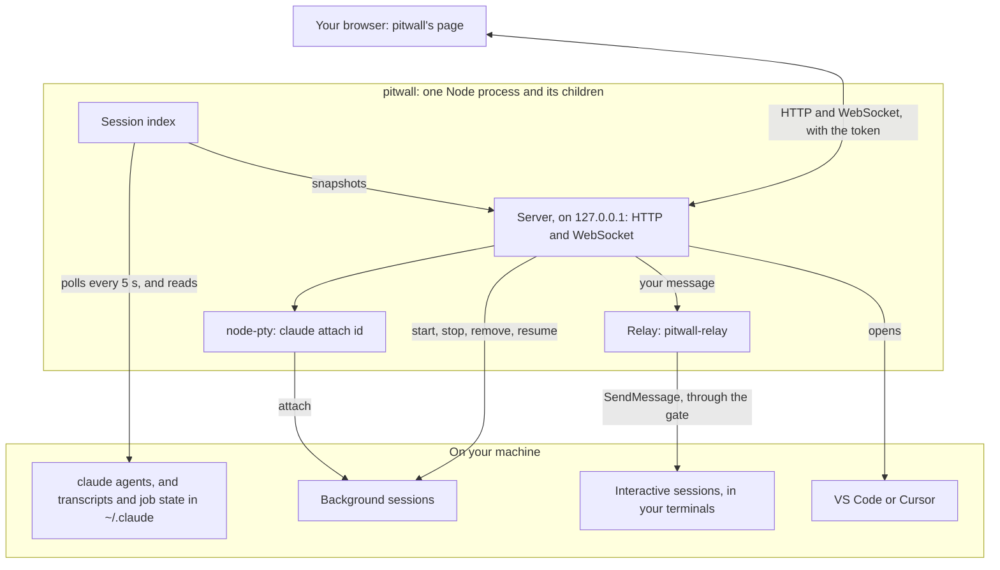
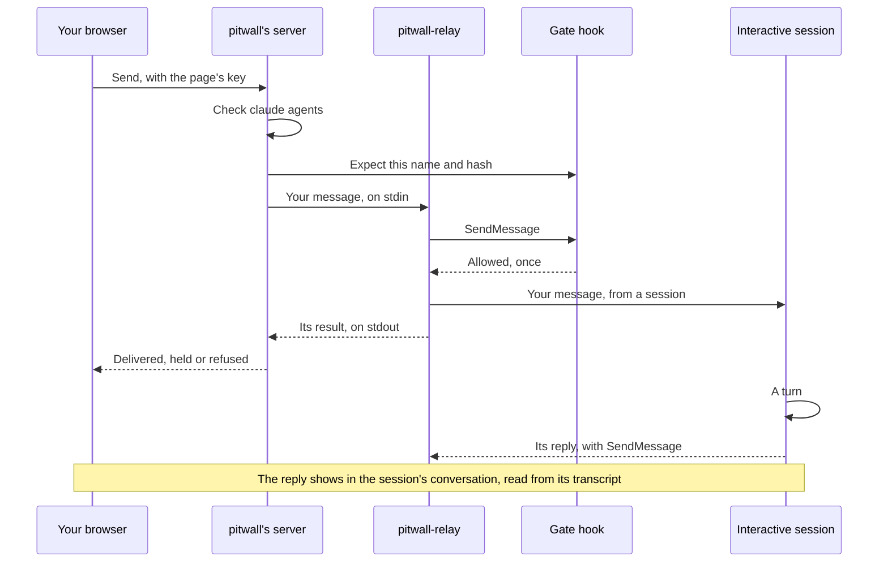

# pitwall

The pit wall for your Claude Code sessions: watch every one on your machine, steer it, and start new ones, from a local web UI.

Run many Claude Code sessions at once, across terminals and repos, and it's hard to see which ones need you. pitwall shows them all in one place, including the sessions it didn't start: the third-party session managers checked before it was built see only the sessions they launch themselves ([D1](docs/decisions.md#d1---the-session-list-comes-from-claude-agents---json---all)).


*The sessions and the conversation in the screenshot are made up.*

## What it does

Claude Code has two kinds of session, and pitwall handles both. Interactive sessions run in your terminals. Background sessions are started with `claude --bg` and run by Claude Code itself, with no terminal of their own.

- **Lists every Claude Code session under a directory,** wherever it was started: Warp, Cursor or any other terminal. Sessions are grouped by git repo, with worktrees under the repo they belong to. Finished background sessions, and interactive sessions that ended recently, stay listed.
- **Shows which sessions need you, and why:** a prompt on screen, a question it asked you, or what Claude Code says a background session needs.
- **Opens a session** to read its conversation, and its sub-agents' in a tab of their own.
- **Lets you steer it:** send an interactive session a message, or drive a background session in a terminal in the page, permission prompts and dialogs included.
- **Starts new sessions** in any directory under a root, with files attached to the first prompt. It also stops and removes background sessions, ends a running interactive session, leaving its terminal at the shell, and brings an ended interactive session back in the background.
- **Opens a session's directory** in VS Code or Cursor.

**Status:** in daily use by its author, on macOS only so far, and still changing quickly. It runs from a clone of this repo and isn't published to npm. The [roadmap](#roadmap) says what's next.

## Try it

### What you need

- **macOS.** It's only been used on macOS. CI builds and tests it on Ubuntu, but nobody has run it on Linux or Windows.
- **Node 22 or later,** with npm. CI uses Node 22.
- **Claude Code,** logged in, with `claude` on your `PATH`. pitwall has been used with Claude Code 2.1.312. The one version it checks: messaging an interactive session needs 2.1.295 or later.
- **git,** to clone the repo, and for grouping sessions by repo.

### Run it

```
git clone https://github.com/leggetter/pitwall.git
cd pitwall
npm ci
npm run build
node dist/cli.js ~/code
```

- **The root:** `~/code` stands for the directory that holds your work. pitwall lists every session whose working directory is in it or below it. Give two or more roots, such as `~/work ~/oss`, to get a tab for each, or none for the current directory.
- **npm's notes:** `npm ci` may say it skipped install scripts for `esbuild`, `fsevents` and `node-pty`, as recent npm 11 releases do by default. On macOS that's fine: `node-pty`, the one native module, loads the macOS build it ships with, and pitwall makes its helper executable the first time it attaches. It may also report advisories in two dev dependencies, Vite and happy-dom. pitwall uses Vite only to build the web UI, never its dev server, and happy-dom only in `npm test`.
- **On Linux,** which is untried, `node-pty` ships no build and compiles in its install script, which needs Python, `make` and a C++ compiler. npm 10 runs that script, as CI does; npm 11 skips it unless it's approved (`npm help install-scripts`). Without it, attaching to a session fails with a message, and the rest of pitwall works.

### What happens

- **Your browser opens pitwall** at `http://127.0.0.1:4517/`, with a token: a random secret for this run, which the page needs to talk to pitwall. pitwall opens it through a launch file in `~/.pitwall/`, so the token is never in a command line that other users can see with `ps`. The page then moves the token out of the address bar.
- **If it doesn't open,** use the link pitwall prints: `pitwall is running at http://127.0.0.1:4517/#token=…`.
- **A new token every run.** A tab from an earlier run can't reconnect, so use the new link. `PITWALL_TOKEN` fixes the token, for a pinned tab on a single-user machine (see [Use](#use)).
- **If port 4517 is busy,** pitwall uses a free port and says so. `--port <n>` picks one, and fails if it's busy.
- **To stop pitwall,** press Ctrl+C in its terminal. Your sessions keep running: a terminal open in the page detaches without stopping its session, and pitwall's relay session, if it started one, stops with it.

### What it reads, and what it does only when you ask

- **It reads, and changes nothing:**
  - `claude agents --json --all`, every 5 seconds, for the list of sessions.
  - Each session's transcript in `~/.claude/projects/`, its sub-agents' transcripts beside it, and a background job's state in `~/.claude/jobs/`, for what it's doing, whether it needs you, which repos it worked in, and the pull requests it opened, pushed to or was given in a prompt.
  - To find ended sessions, the start and end of every transcript in `~/.claude/projects/` changed in the last 30 days, whatever its directory, kept in memory. Only those under your roots are listed.
  - `ps` for when a session's process started, and, before End session, its command name and the parent pids, never a command line; `claude --version` before its relay starts; and `/Applications` and `~/Applications` for VS Code and Cursor.
  - Read-only `git` in the repos under your roots, to group sessions and find the repos each one worked in, and the directories under each root, for New session's list.
- **It acts only when you ask:**
  - **Message** an interactive session, through a headless Haiku session it runs, `pitwall-relay`, which can send only the exact message you wrote, to the session you picked. The session sees it as a message from another session, so a message can't approve a permission prompt.
  - **Attach** to a background session, in a terminal in the page. Opening a running one's view attaches to it by default, since that's where it takes input. One that has finished asks first, because attaching restarts it.
  - **Start** a session with `claude --bg`, and **stop** or **remove** a background one with `claude stop` or `claude rm`, after a confirmation.
  - **End** a running interactive session, after a confirmation, by sending its Claude Code process SIGTERM, never SIGKILL. Its terminal goes back to the shell, and its conversation is kept, but a reply in progress is lost. One that's still working asks again, naming what's running. pitwall never ends a relay, its own or another pitwall's, or a process it runs under.
  - **Resume** an ended interactive session in the background, with `claude --resume <id> --bg`.
  - **Open** a session's directory in VS Code or Cursor.
- **Its own files are in `~/.pitwall/`:** the launch file, its relay's folders, and the files you attach to a new session's first prompt. An attachment is deleted after an hour if it's unused, or 7 days after its session started. `PITWALL_HOME` moves the folder. The relay is a Claude Code session too, so Claude Code keeps its transcript in `~/.claude/projects/`, as it does for every session.

### Security, in brief

A page that can type into your sessions can run code as you, so pitwall guards it. "Security" in [`PLAN.md`](PLAN.md) has the rules, and [`docs/decisions.md`](docs/decisions.md) the reasoning.

- **Localhost only:** the server listens on 127.0.0.1 alone, and trusts no other host name, not even `localhost`.
- **A token:** every API request and the WebSocket need it. The page proves it holds the token over the WebSocket instead of sending it, and anything that changes state also needs a key that only that page gets.
- **`Host` and `Origin` checks:** `Host` must be `127.0.0.1:<port>` on every request, against DNS rebinding. A WebSocket must come from pitwall's own page, an API request from another origin is refused, and there's no CORS.
- **A strict Content Security Policy:** the page loads only pitwall's own files, and no other site can put it in a frame.

### Caveats

- **Undocumented rows:** pitwall finds the interactive sessions running in your terminals through their rows in `claude agents --json`, which Claude Code's docs don't describe: they describe background sessions only. If a release drops those rows, pitwall loses most of its value ([D1](docs/decisions.md#d1---the-session-list-comes-from-claude-agents---json---all)).
- **Internal files:** transcripts, sub-agents' folders and job state are Claude Code's internal formats, which change between versions. pitwall reads them read-only, behind adapters that fail soft: a file it can't read shows as unavailable, or as less detail, never as a crash.
- **A running interactive session can only be messaged, not driven.** For anything more, such as answering a prompt, type `/bg` in the session's terminal to move it to the background, and pitwall can then attach to it ([D2](docs/decisions.md#d2---interactive-sessions-relay-messages-or-bg-for-full-control)).
- **Untrusted directories:** Claude Code won't start a session from a script in a directory you haven't trusted. New session then shows Claude Code's error and the command to run; pitwall never grants trust for you.
- **Cost:** each message you send starts a turn on the target session's own model, plus a Haiku turn in the relay.

## Use

From the clone, after `npm run build`:

```
node dist/cli.js [root...] [--port <n>] [--interval <seconds>] [--no-open]
```

`npm start -- [root...]`, with the same options, runs the same thing.

| Option | What it does | Default |
| --- | --- | --- |
| `root...` | The directories to watch. Sessions whose working directory is in a root or below it are listed. Two or more roots get a tab each | The current directory |
| `--port <n>` | The port on 127.0.0.1. A busy default falls back to a free port; a port you give fails if it's busy. `0` always picks a free one | 4517 |
| `--interval <seconds>` | How often to poll `claude agents`, in whole seconds from 1 to 300 | 5 |
| `--no-open` | Don't open the browser. `PITWALL_NO_OPEN=1` does the same | Opens it |
| `-h`, `--help` | Show the help, with every option and variable | |
| `-v`, `--version` | Show the version | |

- **`PITWALL_TOKEN`:** a fixed token instead of a new one every run, so a pinned tab keeps working across restarts on the same port. It must be at least 32 characters from `A-Z`, `a-z`, `0-9`, `-` and `_`, with at least 8 different ones and not one piece repeated, as in `abcabc…`. It isn't printed. Any page or script that ever saw it can drive every later run that uses it, so use it only on a single-user machine ([D7](docs/decisions.md#d7---the-browser-is-opened-through-a-launch-file-not-a-url-with-the-token-in-it)). pitwall reads it from the environment only, never from a `.env` file.
- **`PITWALL_HOME`:** where pitwall keeps its own files, instead of `~/.pitwall`.

### In the page

- **Three columns:** repos, then the selected repo's sessions, then the open session. Needs you, All sessions and Starred head the repo list. On a narrower window the session view lies over the list, and the repo list becomes a drawer.
- **A session's view** has its conversation, a Terminal tab for a background session, and a Sub-agents tab once it has any. An interactive session's view ends with a message box, where ⌘↵ (Ctrl+Enter elsewhere) sends and Enter adds a line. Its actions menu stops or removes a background session, ends a running interactive one, opens the directory in an editor and copies the session's commands. An ended session's view offers Resume in background.
- **Finished and ended sessions** sit in a Finished section at the end of each list. Not needed now takes a session out of Needs you until what it needs changes.
- **Keyboard:** `/` filters, `n` starts a session, `j` and `k` step to the next or previous session, `s` stars the open session and `?` lists every shortcut. F6 leaves the terminal. The shortcuts dialog can turn the single-key ones off.
- **Preferences:** how to group sessions (by main repo, where they started, or every repo they worked in), which tab a running background session opens on, and whether the terminal takes the keyboard. The header's theme switch follows the system, or sets light or dark.

## How it works

pitwall is one Node process, started by `node dist/cli.js`, with the child processes it runs, and a page in your browser. It works through Claude Code's own commands, and adds no hooks or settings to the sessions it lists. Its one hook is on its own relay session, and a new session started with attachments gets `--add-dir` for each attachment's folder.



- **The index** turns what it reads into a snapshot of the sessions under your roots: each one grouped by repo, with read-only `git`, and whether it needs you. The server pushes a snapshot to the page only when something changed.
- **A conversation** comes over HTTP, a page at a time, and only when you open the session.
- **The terminal in the page** is xterm.js, on its own WebSocket, connected to a pseudo-terminal (PTY) that runs `claude attach <id>`. So you get Claude Code's whole interface, permission prompts included.
- **The relay** exists because the documented way to message an interactive session is Claude Code's cross-session messaging, which only a Claude session can use. So pitwall runs a headless one, `claude -p` named `pitwall-relay`, with `SendMessage` as its only tool, and a gate hook that lets it send only the message you wrote ([D8](docs/decisions.md#d8---messages-to-interactive-sessions-go-through-one-headless-relay-session)).

### Messaging an interactive session

The relay starts on your first message and stops with pitwall. For each message, pitwall checks in `claude agents` that exactly one live session has the name, then writes down what it expects the relay to send: that name and a hash of your text. The gate allows a `SendMessage` only when it matches, once, and blocks anything else, such as a send that another session talked the relay into. The session gets your message as one from another session, and acts on it within its own permissions.



## Roadmap

- **Now, pull requests beside sessions (M4):** your open pull requests, with CI and review state, grouped by repo. A pull request names the sessions that opened it, pushed to it or were given its link, and those sessions' rows get a badge.
- **A supervisor (M5):** a background Claude Code session that pitwall starts and shows in its own panel, which you talk to instead of visiting each session. It lists, summarises, messages and starts sessions, and takes over from the relay. M5 also titles each session from its recent turns rather than its first prompt.
- **Triage (M6):** urgency with reasons, from the index, the supervisor and M4's pull requests. The supervisor reads each idle session's latest turns to judge whether it really needs you. Triage tells "blocked on you" from "blocked on someone else", and pairs pull requests with sessions: "CI is failing on your PR, and the session that opened it is idle."

The detail is in [`PLAN.md`](PLAN.md), and what's been decided in [`docs/decisions.md`](docs/decisions.md).

## Licence

Apache-2.0: see [`LICENSE`](LICENSE). The bundled fonts and icons keep their own licences, listed in [`THIRD_PARTY_NOTICES.md`](THIRD_PARTY_NOTICES.md).

## More

- **[`docs/decisions.md`](docs/decisions.md):** the settled decisions, D1 to D21, with their reasoning.
- **[`PLAN.md`](PLAN.md):** the living plan: status, what's next, open questions, and each milestone's work.
- **[`docs/design-system.md`](docs/design-system.md):** the web UI's design system: tokens, layout, components, content and accessibility.
- **[`docs/spikes/`](docs/spikes/):** the experiments behind the decisions, one write-up each.
- **[`AGENTS.md`](AGENTS.md):** for contributors, people and agents alike: the repo's rules, its commands, such as `npm run dev` and `npm test`, and its layout.
